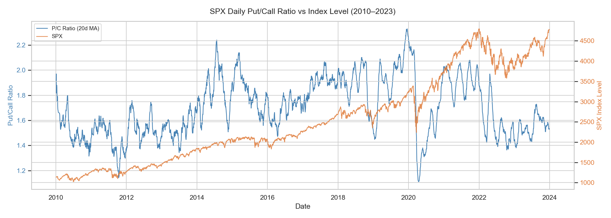
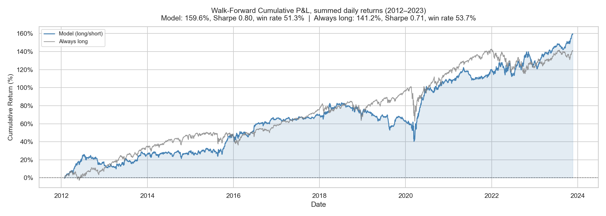
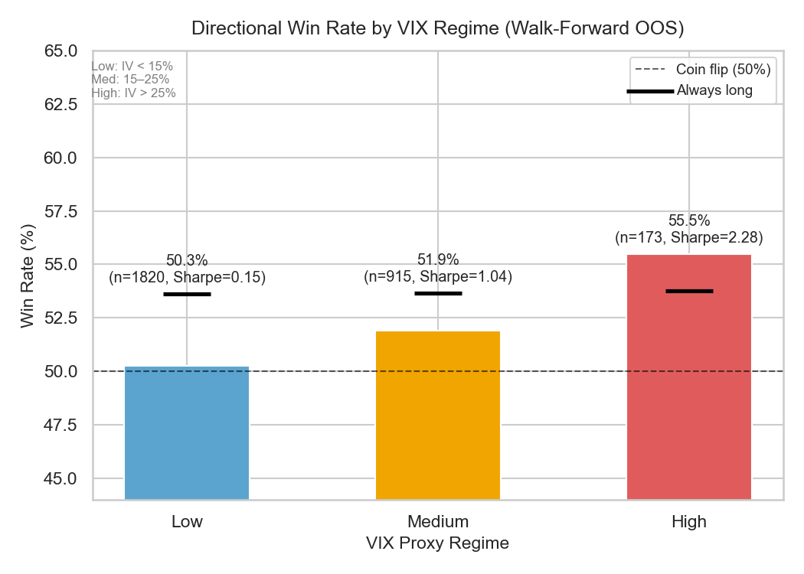
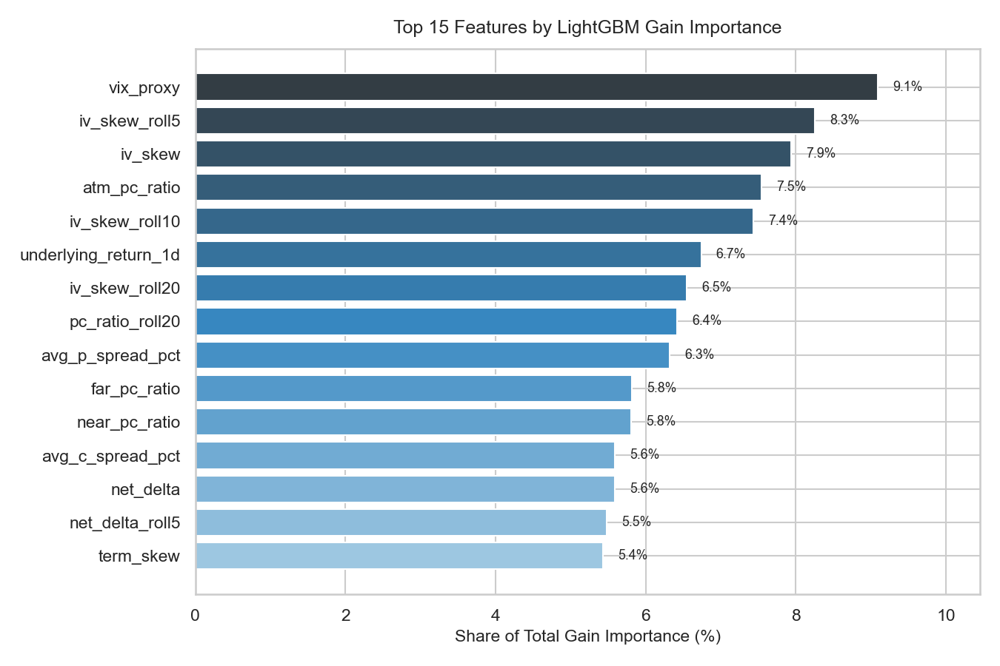

# SPX Directional Signal Pipeline

[](https://github.com/HD013/spx-directional-signal-pipeline/actions/workflows/tests.yml)

A modular, testable Python pipeline demonstrating leakage-aware temporal validation, walk-forward evaluation, feature engineering, calibration and regime-dependent model assessment on 14 years of SPX options data (2010–2023).

The financial dataset serves as a time-dependent prediction testbed. The pipeline architecture and evaluation methods apply to other longitudinal and sequential data, such as sensor streams, monitoring data and epidemiological series.

## What this demonstrates

- **Temporal validation without leakage.** Expanding-window walk-forward evaluation with a purge at the label horizon. Features use only data available at prediction time.
- **Honest benchmarking.** Every result is reported next to always-long and persistence baselines evaluated on the same days.
- **Uncertainty and robustness.** Month-block bootstrap intervals on the edge over the baseline, episode counts per regime, cost breakevens, a decay check, and a sweep over the evaluation's own settings.
- **Calibration and regime analysis.** Reliability of predicted probabilities, and performance by volatility regime with sample sizes.
- **Tested evaluation code.** A synthetic-data test suite checks fold boundaries, feature causality and determinism, and confirms that the pipeline recovers a planted signal and finds nothing when no signal exists.
- **Modular, importable code.** Ingest, features, model and backtest are plain functions with no notebook-only logic.

## Evaluation design

| | |
|---|---|
| Training window | Expanding: all trading days before the test window, minimum 504 (~2 years) |
| Purge | 1 trading day (the label horizon) between training and test |
| Test window / step | 63 trading days (~1 quarter) / 63 days |
| Folds | 47 |
| Out-of-sample days | 2,961 (2012–2023) |
| Model | LightGBM classifier, refit on every fold |

- Each fold's model is fit on past data only. Nothing from a test window is used in training.
- Features for day *t* use only data at or before *t*: rolling features are trailing windows. The target is whether day *t+1*'s close is above day *t*'s.
- There is no fitted preprocessing (no scaling or imputation), so refitting the model per fold keeps all fitting fold-local.
- Hyperparameters and the VIX regime cutoffs (15% and 25%) were fixed before any out-of-sample evaluation and were not tuned afterwards.

## Results

Out of sample, 2,961 trading days, 2012–2023, no transaction costs. Persistence predicts that tomorrow's direction repeats today's.

| Metric | Model | Always long | Persistence |
|---|---|---|---|
| Win rate | 51.3% | 53.7% | 48.6% |
| Sharpe (annualised) | 0.80 | 0.71 | -0.35 |
| Summed daily return | 159.6% | 141.2% | -70.4% |
| Max drawdown (summed) | -42.9% | -38.3% | -100.5% |

By VIX regime (VIX proxy = mean ATM call IV at 25–35 DTE):

| Regime | Days | Win rate (model) | Win rate (always long) | Sharpe (model) | Sharpe (always long) |
|---|---|---|---|---|---|
| Low (< 15%) | 1,820 | 50.3% | 53.6% | 0.15 | 0.57 |
| Medium (15–25%) | 915 | 51.9% | 53.7% | 1.04 | 0.69 |
| High (> 25%) | 173 | 55.5% | 53.8% | 2.28 | 1.66 |

### Statistical checks

Edge over always long, with 90% intervals from a block bootstrap that resamples whole calendar months. An episode is a run of consecutive months.

| | Return edge per year | Win-rate gap | Months | Episodes |
|---|---|---|---|---|
| Overall | +1.6% [-6.9%, +10.0%] | -2.4% [-4.4%, -0.3%] | 143 | 1 |
| Low VIX | -4.3% [-12.4%, +3.9%] | -3.4% [-6.0%, -0.6%] | 113 | 7 |
| Medium VIX | +6.8% [-14.0%, +29.1%] | -1.7% [-5.5%, +1.8%] | 92 | 21 |
| High VIX | +26.0% [-31.6%, +68.8%] | +1.7% [-7.0%, +8.7%] | 27 | 9 |

- **Costs.** The model trades 0.73 units of position per day on average (a long-to-short flip is 2 units). Its return falls to zero at a cost of 7.4 bps per unit traded, and its advantage over always long disappears at 0.9 bps.
- **Calibration.** Of the Brier score's uncertainty component (0.2486), the model resolves 0.0005. The calibration slope is 0.045 to 0.054 across six binnings, where 1.0 means calibrated. The observed up-rate stays between 49% and 57% in every probability bin.
- **Decay.** The win rate is 52.4% over the first 23 folds and 50.2% over the last 24, a difference of -2.3% with a standard error of 1.8%, so no fade is distinguishable from noise.

**Sensitivity to evaluation settings.** Return edge over always long per year, with win rate in brackets, re-run at four purge lengths and scored at three decision thresholds:

| Purge (days) | Threshold 0.45 | 0.50 | 0.55 |
|---|---|---|---|
| 0 | -0.2% (51.9%) | +1.1% (51.1%) | -0.5% (50.9%) |
| 1 | +1.0% (52.0%) | +1.6% (51.3%) | -3.0% (50.4%) |
| 2 | -1.8% (51.0%) | +0.2% (51.4%) | -0.4% (51.1%) |
| 5 | +4.7% (51.6%) | +4.5% (51.3%) | +3.1% (50.7%) |

The edge changes sign across these settings, so whether the model beats always long depends on evaluation choices rather than on the data. The win rate stays between 50.4% and 52.0% in every setting, below always long's 53.7%.

Figures in this section were cross-checked against Zentara Scientific Solutions' internal Evaluation Integrity Toolkit.

**Reading the results**

- The model's win rate is below always long, and the interval on the gap excludes zero. Its return edge (+1.6% per year) is not distinguishable from zero.
- It underperforms always long when volatility is low. The higher medium- and high-VIX figures have intervals that span zero. The high-VIX figures rest on 173 days in 27 months and 9 episodes, with 154 of those days in 2020 and 2022, so they are descriptive, not conclusive.
- Predicted probabilities carry almost no information (resolution near zero, slope near 0.05), and the Brier score (0.308) is worse than a constant forecast (0.249). Only the direction of each prediction is used.
- The signal is weak and sensitive to small changes. Adding the 1-day purge (one fewer training row per fold) changed 13% of daily predictions, and the edge changes sign across evaluation settings.
- 53 out-of-sample days, all in 2012, have no VIX proxy because no liquid ATM option fell in the 25–35 DTE window (expiries were sparser then). They count in the overall figures but not in the regime table, which is why the regime days sum to 2,908.

## Methodology and assumptions

- **Positions:** long SPX (+1) when the predicted up-probability is at least 0.5, short (−1) otherwise. The threshold is fixed, not learned. A signal formed at day *t*'s close earns the close-to-close return from *t* to *t+1*.
- **Baselines:** always long holds SPX every day. Persistence goes long if today's close was up and short otherwise.
- **Sharpe:** mean daily return divided by its standard deviation, times √252. No risk-free rate.
- **Intervals:** 90% percentile intervals from a block bootstrap over calendar months (2,000 resamples, seed 0), applied to the daily difference between the model and always long. Months are resampled rather than days so that clustered days are not counted as independent evidence.
- **Costs:** turnover is the absolute change in position each day, counting the first entry. The breakeven is total gross return divided by total turnover, which is exact for a linear cost.
- **Sensitivity:** one full walk-forward run per purge length. Thresholds are re-scored from the same predictions without retraining.
- **Returns:** "summed" figures add daily returns without compounding, and max drawdown is measured on the same summed series. `print_summary()` also reports compounded returns.
- **Costs in the headline figures:** none (no transaction costs, slippage or financing). The breakevens above show what costs would do.
- **Missing data:** missing feature values (such as the VIX proxy gaps above) are passed to LightGBM, which handles them natively. No rows are dropped for missing features; only the final day, which has no next-day target, is excluded.
- **Feature importance:** chart 4 comes from a model fit on the full sample, for description only. It is never used for evaluation.

## Limitations

Results are historical and research-oriented. They are presented to demonstrate the evaluation pipeline and should not be interpreted as evidence of future trading performance or as investment advice. They cover one asset and one data source (OptionsDX end-of-day snapshots at 16:00 ET).

## Tests

```bash
pip install -r requirements.txt
pytest
```

The suite runs in seconds on synthetic options-chain data generated in `tests/conftest.py`, so no purchased data is needed. It checks:

- **Ingest:** bracketed headers, padded values, malformed rows and the liquidity filter.
- **Features:** one row per day, target alignment, and that truncating future data changes no earlier feature.
- **Backtest:** training never reaches the test window, the purge holds, test days are unique and ordered, and runs are deterministic.
- **Known truth:** with no planted signal the win rate stays near 50%, and with a planted signal the pipeline recovers it, beats the baseline with an interval excluding zero, and keeps a positive edge in every sensitivity setting.
- **Statistics:** each check can fail as well as pass. Intervals include zero for a null and exclude it for a planted effect; block intervals are wider than row-level ones on clustered data; net return is exactly zero at the breakeven cost; the Brier identity holds exactly; a constant forecast has zero resolution; and a planted fade is detected while a flat series is not.

CI runs the suite on every push.

## Structure

```
├── pipeline/
│   ├── ingest.py      # Load and validate raw options data
│   ├── features.py    # Feature engineering (daily collapse)
│   ├── model.py       # LightGBM classifier: train() and predict()
│   ├── backtest.py    # Walk-forward engine, baselines, regime breakdown, sensitivity sweep
│   └── stats.py       # Block bootstrap, episodes, cost breakeven, calibration, decay
├── tests/
│   ├── conftest.py    # Synthetic options-chain generator with optional planted signal
│   ├── test_ingest.py
│   ├── test_features.py
│   ├── test_backtest.py
│   └── test_stats.py
├── notebooks/
│   └── analysis.ipynb # End-to-end walkthrough with charts
├── outputs/           # Pre-generated charts
├── .github/workflows/tests.yml
└── requirements.txt
```

## Setup

```bash
pip install -r requirements.txt
```

> **macOS note:** LightGBM requires OpenMP. Install via `brew install libomp` if you see a `libomp.dylib` error on import.

## Data

The pipeline is designed for [OptionsDX](https://www.optionsdx.com) SPX end-of-day option chain data. Each file contains one row per strike/expiry combination with call and put greeks side by side (wide format), snapshotted at 16:00 ET. The data is not included in this repository.

Place the data files under `data/options_dx/` or pass another directory to `load_all(data_dir=...)`. The loader discovers all `.txt` files recursively, so any folder structure works.

## Usage

### Full pipeline

```python
from pipeline.ingest import load_all
from pipeline.features import build_features
from pipeline.backtest import run, print_summary

raw = load_all()
feat = build_features(raw)
results, metrics = run(feat)
print_summary(metrics)  # baselines, regimes, intervals, costs, calibration, decay

from pipeline.backtest import sensitivity
table = sensitivity(feat)  # purge lengths x decision thresholds
```

### Train and predict independently

```python
import pandas as pd
from pipeline.model import train, predict

model, importance = train(feat, cutoff_date=pd.Timestamp("2022-01-01"))
probs = predict(model, feat[feat["date"] >= pd.Timestamp("2022-01-01")])
signals = (probs >= 0.5).astype(int)  # 1 = predict up, 0 = predict down
```

### Notebook

```bash
jupyter notebook notebooks/analysis.ipynb
```

## Features

The pipeline collapses raw strike-level options data to one row per trading date:

| Feature | Description |
|---|---|
| `pc_ratio` | Total put volume / total call volume |
| `atm_pc_ratio` | P/C ratio for ATM strikes (STRIKE_DISTANCE_PCT < 5%) |
| `near_pc_ratio` | P/C ratio for DTE ≤ 30 |
| `far_pc_ratio` | P/C ratio for DTE > 30 |
| `term_skew` | near_pc_ratio − far_pc_ratio |
| `iv_skew` | Mean put IV − mean call IV for ATM strikes |
| `net_delta` | Σ(C_DELTA × C_VOL) + Σ(P_DELTA × P_VOL) |
| `avg_c_spread_pct` | ATM call bid-ask spread as % of midpoint |
| `avg_p_spread_pct` | ATM put bid-ask spread as % of midpoint |
| `vix_proxy` | Mean ATM call IV for DTE 25–35 |
| Rolling features | pc_ratio, iv_skew, net_delta at 5/10/20-day trailing windows |
| `underlying_return_1d` | Daily SPX return |
| `target` | 1 if next day's SPX close is higher, else 0 |

## Charts






## License

MIT
